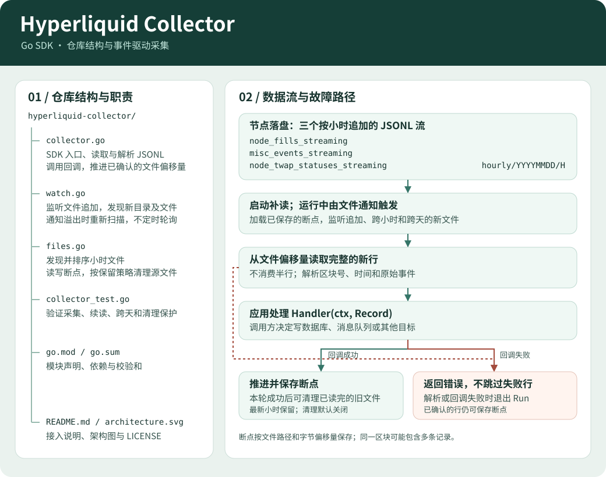

# Hyperliquid Collector

从 Hyperliquid 节点采集成交（fills）、杂项事件和 TWAP 状态的 Go SDK。支持断点续读和可选的源文件清理；不依赖数据库。

## 架构与采集流程



## 快速接入

### 1. 准备节点

启用 `--write-fills --write-misc-events --stream-with-block-info`，用 `--stream-with-block-info` 替换 `--batch-by-block`。可加 `--disable-output-file-buffering` 降低写入延迟。

把节点数据根目录（例如 `/home/hl/hl/data`）传给 SDK，而不是某个流的子目录：

```text
<DataDir>/
  node_fills_streaming/hourly/YYYYMMDD/H
  misc_events_streaming/hourly/YYYYMMDD/H
  node_twap_statuses_streaming/hourly/YYYYMMDD/H
```

需要 Go 1.24+、Linux 或 macOS，以及支持文件通知的本地磁盘。采集程序需要读取权限；同机部署可用 `hl` 用户运行，不用放开节点家目录。

### 2. 启动采集

```go
import (
    "context"
    "log"

    collector "github.com/luanruisong/hyperliquid-collector"
)

func collect(ctx context.Context) error {
    sdk, err := collector.New(collector.Config{
        DataDir: "/home/hl/hl/data",
    })
    if err != nil {
        return err
    }
    return sdk.Run(ctx, func(ctx context.Context, record collector.Record) error {
        for _, event := range record.Events {
            log.Printf("%s block=%d block_ms=%d local_ms=%d event=%s",
                record.Stream, record.BlockNumber, record.BlockTime.UnixMilli(),
                record.LocalTime.UnixMilli(), event)
        }
        return nil
    })
}
```

`Run` 持续阻塞，直到取消 `ctx` 或发生错误。每次回调收到一条完整的 JSONL 记录。fills 的 `Events` 元素是 `[账户地址, 成交对象]`，misc 和 TWAP 的元素是事件对象。`BlockTime` 和 `LocalTime` 保留原始精度，示例用 `UnixMilli()` 输出毫秒。

## 配置

| 字段 | 默认值 | 用途 |
| --- | --- | --- |
| `DataDir` | 必填 | 已存在的数据根目录。 |
| `CheckpointPath` | `DataDir/.hyperliquid-collector.json` | 断点文件，父目录必须已存在且可写。重启时沿用同一路径。 |
| `MaxRecordBytes` | 8 MiB | 单条 JSONL 记录大小上限，含换行。 |
| `Retention` | `0` | 源文件保留时长，零值不清理。 |

## 监听与续读

- **不轮询**：启动时从断点补读已有文件；之后用 `fsnotify` 监听追加，并发现新建的数据流、日期目录和小时文件。通知队列溢出时重新扫描；不保证收到 NFS 等远程文件系统的通知。源文件应仅追加，不要原地替换或截断。
- **成功才确认**：回调返回 `nil` 才推进断点。接入数据库时，先持久化再返回。遇到回调失败、坏记录或超长记录时，`Run` 返回带文件和偏移量的错误，不跳过失败记录。
- **允许重放**：异常退出可能重读已处理但尚未保存断点的记录。可用 `Record.Path`、`Record.Offset` 和行内事件序号幂等写入。流之间不保证全局顺序，同一区块可有多条记录，不要按区块号去重。

## 磁盘清理

`Retention: 72 * time.Hour` 会清理已完整采集、且所属小时结束时间和文件修改时间都超过 72 小时的源文件。每个流最新小时的文件始终保留；未读完或仍有变化的文件不删。不清理节点快照、日志或其他数据，也不按磁盘空间触发。

清理只在启动和对应数据流变化后检查，没有独立定时器。启用前确认其他消费者不再需要这些文件，并给采集程序对应目录的写权限。

## 开源许可证

本 SDK 采用 [MIT 许可证](./LICENSE)。
